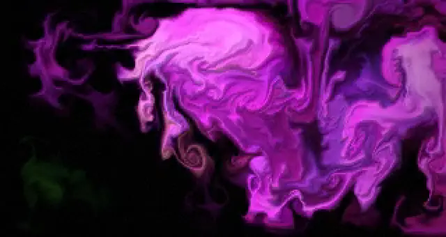
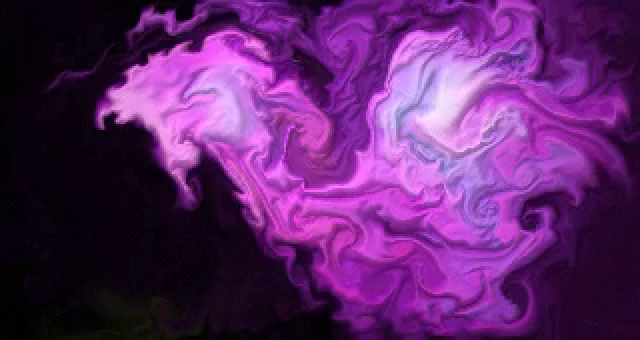
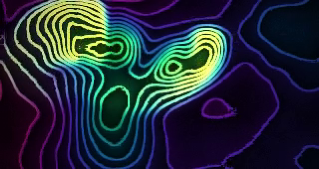
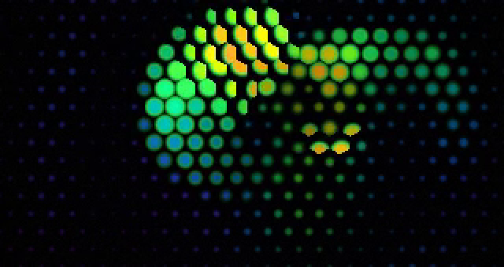
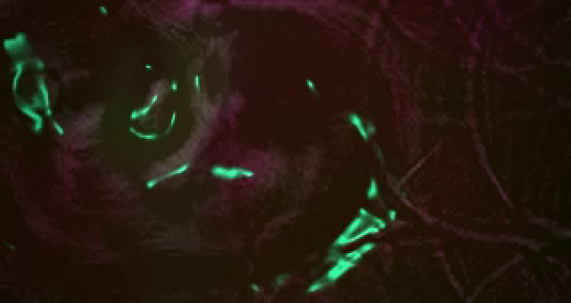
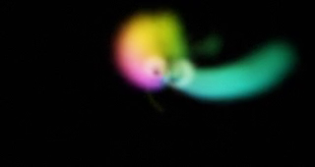
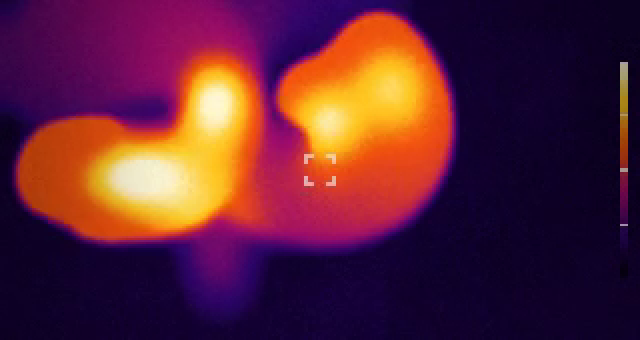

# Wake Zero



Abstract art from a camera, on the [M5Stack CardputerZero](https://docs.m5stack.com/en/CardputerZero): a
credit-card-sized Linux computer (Raspberry Pi CM0, VideoCore IV GPU, 320x170 screen, 8 MP camera).

Point it at someone and the art is the wake they leave as they move. The camera picture is never shown or stored:
each frame is reduced to 128x72 greyscale, then to blurred brightness, motion and optical flow, and only those
fields drive the art. It's a native port of Wake, a browser piece (try it with your webcam at
[wake.batesyboy.com](https://wake.batesyboy.com); nothing leaves your browser), to OpenGL ES 2.0 on a GPU from 2012.

Built with [Claude](https://claude.ai) (Anthropic's AI): I came up with it, directed it and tested it on the
hardware; Claude wrote most of the code.

## Scenes

| Key | Scene | |
|---|---|---|
| 1 | **Ink** | A fluid simulation. Movement drags the fluid along and pours in ink, coloured by its direction. |
| 2 | **Strata** | A creeping contour map. Whoever is in view raises the terrain; movement heats the lines. |
| 3 | **Lattice** | A hex field of dots that swell, shove and light up with movement. |
| 4 | **Ripple** | A water surface. Movement presses in and leaves a wake; raindrops fall; caustics shimmer. |
| 5 | **Echo** | Video feedback. Movement pours light into an endless spiralling tunnel. |
| 6 | **Thermal** | A heat camera. You glow in false colour and leave a warm haze that drifts up as it cools. |

| | |
|---|---|
|  |  |
|  |  |
|  |  |

*Rendered by Wake Zero's own code headlessly, with its built-in simulated camera (`--camera fake`: a figure
waving its arms) in place of a person; on the device the input is you.*

**Space** / **Enter** / **→** next scene · **←** previous · **1–6** pick one · **P** palette · **A** auto-cycle
(every 90 s) · **F** flip the camera 180° (on by default: the CardputerZero's camera is mounted upside down) ·
**M** mirror (for a camera facing you) · **S** snapshot · **V** start/stop recording · **L** NDI output on/off ·
**C** camera on/off ·
**D** show the analysis fields and frame rate · **Q** or **Esc** quit. Settings are kept in
`~/.config/wake-cardputer`.

## NDI® output

Press **L** and Wake appears on your network as an NDI source called **Wake Zero**: pick it in OBS (with the
[DistroAV](https://github.com/DistroAV/DistroAV) plugin), NDI Studio Monitor, TouchDesigner, vMix, Resolume or any
other NDI receiver. No addresses to type: NDI sources find each other. It sends the clean picture (no on-screen
labels) at 640x340, 2x with hard pixel edges, at the frame rate Wake is running. A red NDI shows in the corner while
it's on, and **D** shows how many receivers are watching. Press **L** again to stop. `--ndi` starts with it on.

The camera faces away from the screen, so this is also how you watch yourself: point it at you and watch on your
computer. The device and the computer must be on the same network. NDI finds sources with mDNS, which office and
venue networks often block: if Wake Zero doesn't appear in the list, add the CardputerZero's IP address in **NDI
Access Manager** (*Remote Sources*) on the receiving computer and it connects directly.

NDI needs NDI's own library, which isn't bundled: it's under the NDI SDK licence. The installer offers to fetch it
from NDI for you, or run `sudo ./install-ndi.sh` from the unpacked folder later. If L says *NDI not installed*,
that's the step to run.

NDI® is a registered trademark of Vizrt NDI AB. See [ndi.video](https://ndi.video/).

## Snapshots and recordings

Both go through `ffmpeg` (already on the CardputerZero image) and carry the clean picture.

- **S** saves a PNG, scaled up 4x with hard pixel edges (1280x680), to `~/Pictures/wake/`.
- **V** records H.264 MP4 at the screen's native 320x170 to `~/Videos/wake/` (a red dot shows while it records).
  To scale one up crisply on your computer:
  `ffmpeg -i wake.mp4 -vf scale=iw*4:ih*4:flags=neighbor -c:v libx264 -crf 16 wake-4x.mp4`

**A tour for docs and posts:** `wake --tour 12 --record` shows every scene once for 12 seconds, records the whole
run as one MP4, saves a PNG of each scene and quits (your saved settings are left alone). Move about in front of
the camera while it runs: the art is made from movement.

Without NDI, `--stream udp://<computer>:5000` sends plain H.264 over UDP instead (open `udp://@:5000` in VLC).

## Install

On the CardputerZero (needs Wi-Fi):

```sh
rm -rf /tmp/wake-zero && mkdir /tmp/wake-zero &&
curl -fsSL https://github.com/b8z-io/wake-zero/releases/download/latest/wake-zero.tar.gz | tar -xz -C /tmp/wake-zero &&
sudo /tmp/wake-zero/install.sh
```

Or from your computer over SSH: `package/deploy.sh pi@<device address>`.

The installer adds any missing libraries (`libegl1 libgles2 libgbm1 libegl-mesa0 libgomp1 rpicam-apps-lite`), puts Wake in
the launcher and makes sure the launcher's user is in the `video`, `render` and `input` groups. It needs the
camera working (`rpicam-hello --list-cameras` should list the imx219); without one it still runs, on its own.

If the picture is sideways, add `--rotate 90` (or `270`) to `Exec=` in
`/usr/share/APPLaunch/applications/wake.desktop`; if the colours are wrong, add `--swap`.

## How it works

- **`src/gfx.c`**: OpenGL ES 2.0 through EGL with no window: GBM on `/dev/dri/renderD128`, or Mesa's surfaceless
  platform elsewhere. Everything renders into textures.
- **`src/main.c`**: each frame is read back (`glReadPixels`, 320x170) and written to `/dev/fb_lcd` in the
  panel's pixel format. It runs as an ordinary launcher app (`package/wake.desktop`).
- **`src/camera.c`**: `rpicam-vid` at 256x144 YUV420 on a pipe; the luma is averaged down to 128x72.
- **`src/analysis.c`**: auto-levels, motion over a noise floor, trails, Lucas–Kanade optical flow. A port of
  Wake's JavaScript (`reference/`); `tests/parity.sh` checks they agree to float precision.
- **`src/scenes.c`**: the scenes in GLSL ES 1.00. VideoCore IV can only render to 8-bit targets, so:
  - feedback (Echo, Thermal) uses dithered rounding, so trails fade all the way out instead of sticking;
  - Ripple packs each wave height into two channels as 16-bit fixed point and blends between texels itself,
    since texture filtering rounds to 8 bits;
  - the camera's brightness field goes up with 16 bits the same way, so contour lines stay smooth;
  - Ink's fluid (stable fluids with vorticity, as in the browser) needs floating-point render targets, so it runs
    on the CPU instead, across all four cores with OpenMP (`src/ink.c`): 128x68 for the velocity and pressure,
    the full screen for the ink. The GPU only shades the result.

## Building and testing

```sh
sudo apt install gcc make libegl-dev libgles-dev libgbm-dev     # on the device, or any Debian/Ubuntu
make
./wake --camera fake --scene 2 --out /tmp/frames --frames 300 --every 30   # headless: PPM frames
tests/parity.sh                                                         # C analysis vs the JavaScript
```

CI runs both, builds the arm64 binary on Debian trixie and publishes it as the `latest` release.

## Support

Wake Zero is free and open. If it made you smile, you can
[buy me a coffee](https://buymeacoffee.com/batesyboy) or [sponsor me on GitHub](https://github.com/sponsors/b8z-io).
More of what I make: [socials.batesyboy.com](https://socials.batesyboy.com).

